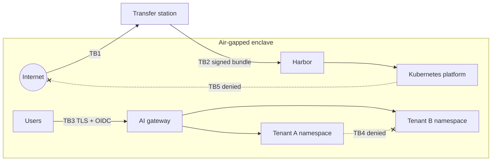

# Threat Model — Sovereign AI Platform

Companion to *Sovereign AI Stacks*, Chapter 1. Review this document whenever a component, data class or trust boundary changes, and at least once per quarter.

## 1. Scope

An on-premises, air-gapped LLM platform serving several tenants (ministries, departments or business units). It provides chat, RAG over internal documents and an OpenAI-compatible API.

## 2. Assets

| ID | Asset | Classification | Owner |
|---|---|---|---|
| A1 | Tenant documents ingested into RAG | Up to SECRET / bank-confidential | Tenant data owner |
| A2 | Prompts and responses | Same as the most sensitive input | Tenant data owner |
| A3 | Audit log of prompts and responses | Confidential, regulated retention | Platform security officer |
| A4 | Model weights | Integrity-critical; licence-bound | Platform team |
| A5 | Container images and Helm charts | Integrity-critical | Platform team |
| A6 | Identity data (users, groups, clearances) | Confidential | Identity administrator |
| A7 | Cryptographic keys (cosign, TLS CA, OIDC signing) | Secret | Platform security officer |
| A8 | GPU capacity | Availability-critical | Platform team |

## 3. Trust Boundaries

| ID | Boundary | Crossed by |
|---|---|---|
| TB1 | Internet ↔ transfer station | Upstream downloads of images, models, packages |
| TB2 | Transfer station ↔ enclave | Signed bundles via data diode or controlled media |
| TB3 | User network ↔ platform ingress | Browser and API traffic over TLS |
| TB4 | Tenant namespace ↔ tenant namespace | Must never be crossed by data |
| TB5 | Platform workloads ↔ enclave egress | Must never reach outside the enclave |
| TB6 | Platform admin ↔ tenant data | Break-glass only, logged |

## 4. Threats (STRIDE)

| ID | STRIDE | Threat | Asset | Control | Chapter |
|---|---|---|---|---|---|
| T1 | Information disclosure | A workload sends telemetry, prompts or documents to an external endpoint | A1, A2 | Cilium default-deny egress; Hubble flow audit; preflight egress probe | 1, 4 |
| T2 | Tampering | Model weights altered in transit or at rest (corruption or deliberate backdoor) | A4 | SHA-256 manifests, cosign signatures, hash check in the model init job | 3, 5 |
| T3 | Tampering | Malicious or vulnerable container image imported into the enclave | A5 | Digest pinning, SBOM, offline vulnerability scan, Kyverno signature enforcement | 3, 10 |
| T4 | Information disclosure | Tenant A retrieves Tenant B's documents through RAG | A1 | Per-tenant collections, ACL filters from JWT claims, audience validation | 7, 8 |
| T5 | Information disclosure | Cached responses served across clearance levels | A1, A2 | Cache key includes tenant and ACL scope | 8 |
| T6 | Spoofing | Forged or replayed tokens used against the gateway | A6 | OIDC with short-lived tokens, issuer and audience checks, clock sync | 7 |
| T7 | Elevation of privilege | Prompt injection makes an agent or tool act beyond the user's rights | A1, A2 | Tool permissions bound to user identity; injection red-team suite | 10, 11 |
| T8 | Repudiation | User denies issuing a prompt; no evidence exists | A3 | Immutable audit sink with user, tenant, model and timestamp | 10 |
| T9 | Information disclosure | Audit logs themselves contain unredacted personal data | A3 | PII redaction before persistence; role-based log access; retention limits | 10 |
| T10 | Denial of service | One tenant's batch workload starves interactive users | A8 | Per-key rate limits, priority tiers, separate batch routes | 6 |
| T11 | Elevation of privilege | Platform administrator reads tenant data without authorisation | A1, A2 | Separation of duties, break-glass workflow, access reviews | 7 |
| T12 | Tampering | Signing key compromised; attacker signs their own images | A7 | Offline key ceremony, HSM or split custody, key rotation runbook | 3, 10 |
| T13 | Information disclosure | Model memorises and reproduces sensitive fine-tuning data | A1, A4 | No fine-tuning on classified data without review; extraction tests | 11 |
| T14 | Denial of service | Single storage failure destroys both platform and backups | A1, A3, A4 | Backups on separate storage; timed DR drills | 12 |

## 5. Residual Risk Register

| ID | Residual risk | Accepted by | Review date |
|---|---|---|---|
| R1 | Open-weight model behaviour cannot be fully verified; provenance relies on the publisher's attestation and our evals | *(name, role)* | *(date)* |
| R2 | Physical media transfer depends on procedural chain of custody | *(name, role)* | *(date)* |
